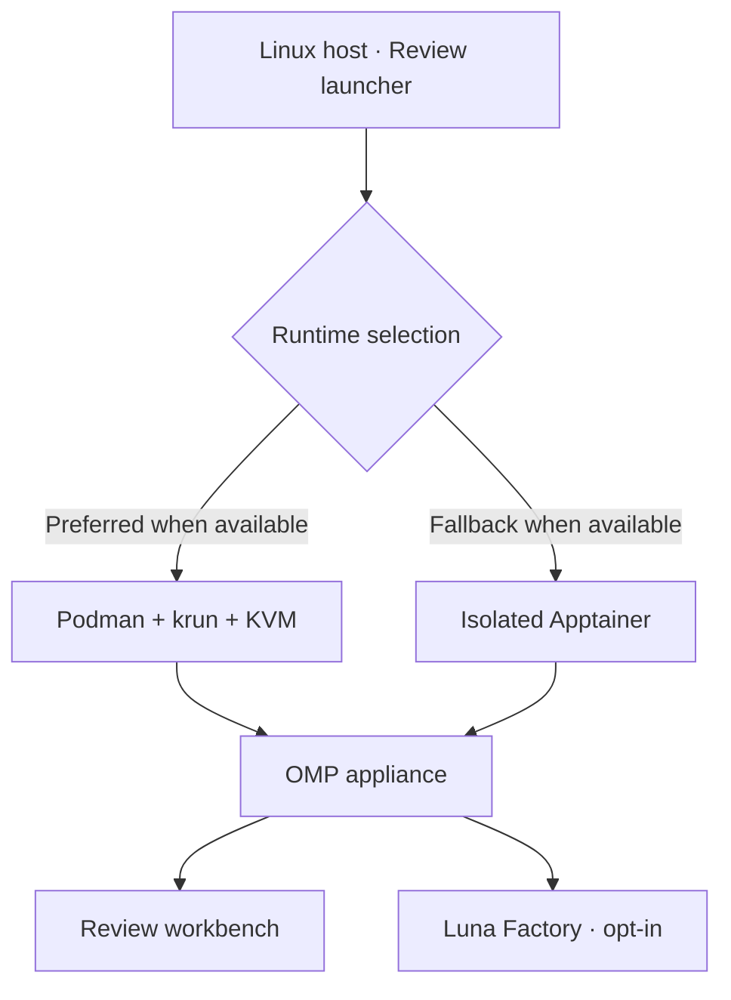
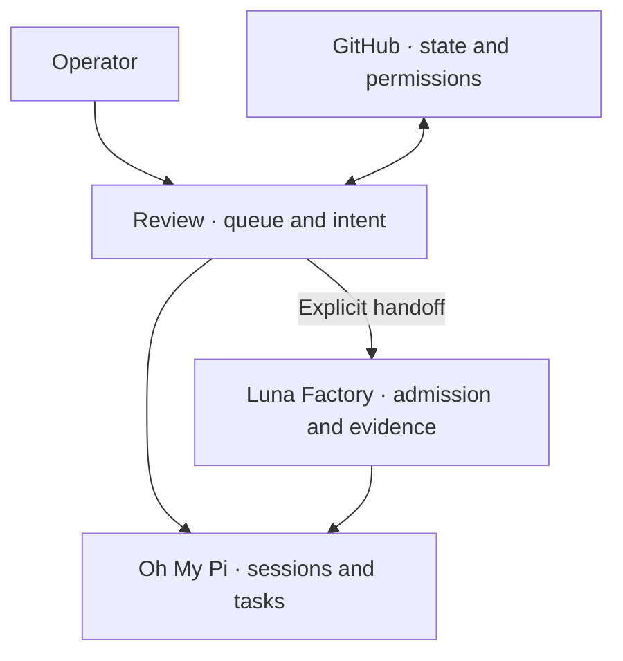

# Review

### Your GitHub work, in an isolated agent workbench.

Review brings pull requests and issues into a terminal workbench for inspection, review, and bounded action. It runs on [Oh My Pi (OMP)](https://github.com/can1357/oh-my-pi). The appliance also packages **Luna Factory**, an opt-in controller for bounded worker batches with their own claims, evidence, and recovery state.

[Start here](#quick-start) · [Explore the runtime](#inside-the-appliance) · [Review workbench](docs/workbenches/review.md) · [Luna Factory](docs/workbenches/factory.md) · [Documentation](docs/SKILL.md)

## Inside the appliance

A launch begins on your Linux host. Review chooses a supported runtime, brings up the packaged workbench in the foreground, and keeps its session state in an appliance-owned home. From there, choose whether to inspect GitHub work in Review or admit a bounded batch to Luna Factory.



**[Open the interactive runtime explorer](docs/workbenches/runtime.html)** by downloading the file or opening it from a checkout in a browser. GitHub displays HTML source rather than running its scripts. The explorer is a schematic, not a runtime monitor.

| Runtime | Selection and prerequisites | Boundary |
| --- | --- | --- |
| Podman + krun | Preferred in automatic mode when Podman, krun and KVM are available. Explicit `krun` does not silently downgrade. | OCI appliance using krun and KVM. |
| Apptainer | Automatic fallback when available, or select explicitly. Requires Apptainer, squashfuse and accessible FUSE. | Isolated Apptainer SIF/OCI path; not a krun VM. |
| Source | `bin/review-source` uses a locally installed OMP. | Runs outside the packaged appliance; it is a different execution boundary. |

With Factory enabled, the selected packaged runtime must pass its verifier preflight and a sandbox test before OMP opens. Failure blocks that startup. See [appliance setup](docs/appliance.md) for prerequisites and the full boundary.

## Quick start

The packaged appliance requires Linux, GitHub CLI and a supported runtime. The Homebrew package installs the launcher and matching appliance image. Authenticate with the access appropriate to your repositories; GitHub permissions and rules remain authoritative.

```sh
brew install joshyorko/tools/review
gh auth login --web --hostname github.com --scopes repo,read:org,workflow
review acme/widgets
```

Replace `acme/widgets` with your repository, or use `org:acme` for an organization. The scope above is an example. A fresh interactive session can also ask for a scope. `REVIEW_DEFAULT_SCOPE` sets an explicit default. Headless use without a scope reports that `owner/repo` or `org:<name>` is required. Authenticate separately with your model provider before using it. See [appliance setup](docs/appliance.md) for provider and runtime setup.

From a source checkout, the appliance and source entry points are:

```sh
just review-doctor
just review-queue acme/widgets
just review-queue org:acme
bin/review-source org:acme
```

`just review-doctor` is a read-only preflight; it starts no agent. The `just` appliance recipes and `bin/review-source` have different dependencies and configuration from the installed launcher; see the [launcher guide](docs/skills/launcher.md).

## Two workbenches, one runtime

### Review · See the work, inspect the evidence, decide what happens next


*Real source-runtime capture using a deterministic GitHub fixture; it does not show a live repository or completed agent work. [Capture notes](docs/evidence/review-workbench/2026-10-29/cloud-ansi/README.md).*

Review projects a GitHub repository or organization into a queue and trace. Navigate between pull requests and issues, inspect bounded evidence, select work, and explicitly confirm actions. Slay coordinates a bounded review/repair lifecycle; Fix uses isolated workspaces. Review specialist agents are read-only and their verdicts do not themselves authorize mutation.

**[Explore the Review workbench →](docs/workbenches/review.md)**

### Luna Factory · Admit, execute, and verify bounded work

Factory is co-loaded with Review, but loading it starts no work. Enable execution explicitly with `LUNA_FACTORY_ENABLED=1`. Factory owns admission, attempts, claims, evidence, and reconciliation; seeing an item in Review does not admit it. Factory completion does not confer landing or deployment authority.

**[Explore the Luna Factory workbench →](docs/workbenches/factory.md)**

| Capability | Review | Luna Factory |
| --- | --- | --- |
| Primary surface | GitHub pull-request and issue queue | Admitted batches and their evidence |
| Main purpose | Inspect, review, and coordinate confirmed actions | Execute bounded native worker operations and verify outcomes |
| Authority | Human intent plus live GitHub permissions and Review guards | Separate admission, claims, receipts, and acceptance; no automatic landing authority |
| State | Review intent, selection and trace | Factory-owned durable task and attempt state |

## How the pieces fit



OMP provides sessions, agents, tools, task execution, model resolution, and cancellation. Review provides the GitHub projection and mutation guards. Factory is a separate execution controller. The repository packages Review and Factory as OMP extensions; consult the [agentic model](docs/factory/agentic-model.md) for the authority contract. VS Code integration is separate from this terminal appliance; consult its own implementation and documentation before assuming feature parity.

## Configure and troubleshoot

- **Choose a runtime:** `review --runtime apptainer acme/widgets` or `review --runtime krun acme/widgets`. Use `review configure personal` to save a host launch profile. These options apply to the installed launcher and `bin/review`, not `just review-appliance` or `bin/review-source`.
- **Keep or inherit OMP settings:** the appliance isolates host OMP configuration by default. Set `REVIEW_INHERIT_OMP_CONFIG=1` only when intentionally inheriting it.
- **Check startup:** run `just review-doctor` from a checkout and follow the reported runtime and Factory verifier prerequisites. Explicit krun requires KVM; Apptainer requires its own FUSE prerequisites.
- **Resume safely:** Review can retain paused work, but it rechecks current GitHub state and admission before continuing. Unknown external effects require reconciliation, not blind retry. See [Review recovery](docs/skills/review-dashboard.md#interrupted-wave-recovery).
- **Check provider access:** the appliance skips OMP's first-run wizard; authenticate with each provider before using it. Profiles select approved environment names, not credential values. See [host launch profiles](docs/appliance.md#host-launch-profiles).

## Providers and integrations

OMP resolves models and manages provider authentication. The launcher supports approved credential groups for OpenAI, Anthropic, Gemini, Copilot, AWS SDK, Bedrock bearer and TypeSafe; selection and credential presence do not prove authentication or model availability. Host launch profiles can select groups or approved variable names. See [host launch profiles](docs/appliance.md#host-launch-profiles) for exact controls.

Review and Factory are bundled OMP extensions. The appliance owns its OMP profile and MCP configuration by default; host configuration is an explicit opt-in. The VS Code extension is separate from the terminal appliance; check its documentation for its current capabilities.

## Security and trust

Isolation reduces exposure; it does not grant GitHub permissions or make arbitrary agent output trustworthy. The appliance has its own persistent home and target-specific workspace and scratch directories. Credentials are passed through approved environment inputs; host OMP configuration is not inherited by default. Review checks current subjects, permissions, rules, and claims before mutations. Factory uses separate admission and verification. Read [the agentic model](docs/factory/agentic-model.md) and [appliance setup](docs/appliance.md) before relying on a particular boundary.

## Contribute and learn

Start with [AGENTS.md](AGENTS.md), the [agentic model](docs/factory/agentic-model.md), and the [documentation index](docs/SKILL.md). For setup and tests see [image and development](docs/image-and-development.md); for changes and PRs see [contribution culture](docs/skills/contribution-culture.md) and [PR workflow](docs/skills/pr-workflow.md).

`review changelog` shows the bundled release history offline. Licensed under [Apache 2.0](LICENSE). [Visual credits](docs/images/README.md).

## Release maintenance

Run `review changelog` for the bundled release history. Maintainers can preview a release with `just changelog 0.1.4`. Install the pinned authoring tool into a disposable directory with `bash scripts/install-git-cliff.sh /tmp/review-git-cliff`, then add it to `PATH`. The request-release workflow installs it automatically.

In **Request Review release**, select `patch`, `minor`, or `major`, or supply an exact version without a `v` prefix. The workflow opens a PR containing `VERSION` and a git-cliff draft in `CHANGELOG.md`. Review the notes before merging. Passing main validation triggers publication; the matching committed section is packaged with build provenance. The baseline `v<CURRENT_VERSION>` tag must exist and be an ancestor of the source commit.
