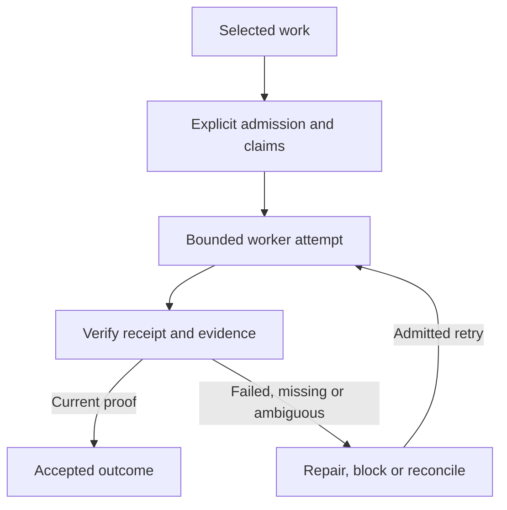

# Luna Factory workbench

**Bounded worker batches with explicit admission, durable claims, and evidence.** Luna Factory is an OMP extension packaged alongside Review. It owns its execution state separately from Review's GitHub queue.

[Main README](../../README.md) · [Review workbench](review.md) · [Factory operating model](../factory/agentic-model.md) · [Factory operations](../skills/factory-operations.md)


*Historical packaged-runtime checkpoint, rendered from actual tmux terminal captures with deterministic local GitHub and model fixtures. No production GitHub PR was created, and live GitHub/provider qualification is outside this checkpoint. The UNKNOWN outcome is not proof of completion. [Capture context and limits](../factory/dashboard-checkpoint.md).*

## Enable and inspect

Factory execution is opt-in. The following enables the packaged launch; it does not itself dispatch a batch:

```sh
LUNA_FACTORY_ENABLED=1 review acme/widgets
```

Factory-enabled startup qualifies the selected runtime with a verifier preflight and a harmless sandbox test. A failed probe blocks startup. In an interactive session, `/factory` opens the dashboard. From Review, `F` opens the Factory action picker when the extension is loaded. See [Factory dashboard controls](../appliance.md#factory-dashboard).

## Run a first inspection batch

Authenticate with GitHub and your model provider before launch; see the [quick start](../../README.md#quick-start). Replace `acme/widgets` above with your repository.

1. Open `/review` if its queue is not already visible. Press `x` to clear any previous selection, use `Tab` to choose the PR or issue queue, and move with `j` / `k`.
2. Check the focused item's repository and number, then press `Space` to select it. Factory uses explicitly selected items; a focused row alone is not a selection.
3. Press `F` (`Shift+F`). Check the selected-item and repository counts in the action picker, then choose **Inspect only**. Choosing an outcome submits the batch and can start workers immediately; choose **Cancel** to leave it unsubmitted.
4. The submitted batch ID appears in a notification and its Factory dashboard opens. Inspect the selected run, item state, blocker and next action. Startup or admission can block work; submission is not proof that a worker ran.
5. Press `Enter` for item details and `e` for retained evidence. Read the recorded outcome and acceptance evidence before treating the inspection as complete. Press `q` or `Esc` to return; closing the dashboard does not pause or stop execution.

The picker offers three bounded outcomes:

| Choice | Intended result |
| --- | --- |
| Inspect only | Research selected work without changing it. |
| Implement locally | Make and verify a change, stopping before opening a PR. |
| Implement and prepare PR | Make and verify a change, then prepare it for review; no merge or deployment authority. |

Writable batches capture detected Go, Node or Python checks before editing. Missing toolchains or known unprepared dependencies can block before a worker attempt; unknown repositories need explicit `requiredChecks` through the [batch interface](../../image/extension/luna-factory/README.md). See that reference for command-based submission and the complete execution contract.

## Lifecycle



A returned worker is not proof of success. Factory checks the receipt against the current task, attempt, generation and subject. Changed subjects can invalidate earlier proof. Missing or contradictory evidence stays blocked or unknown. Claims coordinate single-writer resources; cancellation or stop does not imply that external effects were rolled back.

`CONVERGED` means all mandatory acceptance criteria have current valid proof. `QUIESCENT` means no authorized autonomous progress remains; it may still be unconverged. A visible Review row does not admit work, and Factory completion grants no approval, merge, publication or deployment authority.

## Inspect and resume

Open `/factory` to return to retained work. Press `b` for batch history, `j` / `k` to select, and `Enter` to open a run or item. Press `a` for actions available in the current state, `c` for ownership, `e` for evidence, `v` for a recorded worker session, and `?` for help.

For textual controls, use `/factory status` to find the exact batch ID, then replace `<batch-id>` below:

| Command | Effect |
| --- | --- |
| `/factory inspect <batch-id>` | Read the batch's item state and evidence. |
| `/factory pause <batch-id>` | Pause new starts; existing work can remain active. |
| `/factory resume <batch-id>` | Resume work allowed by the retained state and admission checks. |
| `/factory stop <batch-id>` | Prevent further dispatch; external effects are not rolled back. |
| `/factory reconcile <batch-id>` | Recheck unsettled effects; this can contact GitHub. |

Retained runs keep their attempts and evidence; the same-host state root is authoritative for ownership and recovery. UNKNOWN external effects require reconciliation before any eligible retry. Review the [operating model](../factory/agentic-model.md), [batch reference](../../image/extension/luna-factory/README.md) and [Factory operations](../skills/factory-operations.md) before acting on a blocked or unknown outcome.
