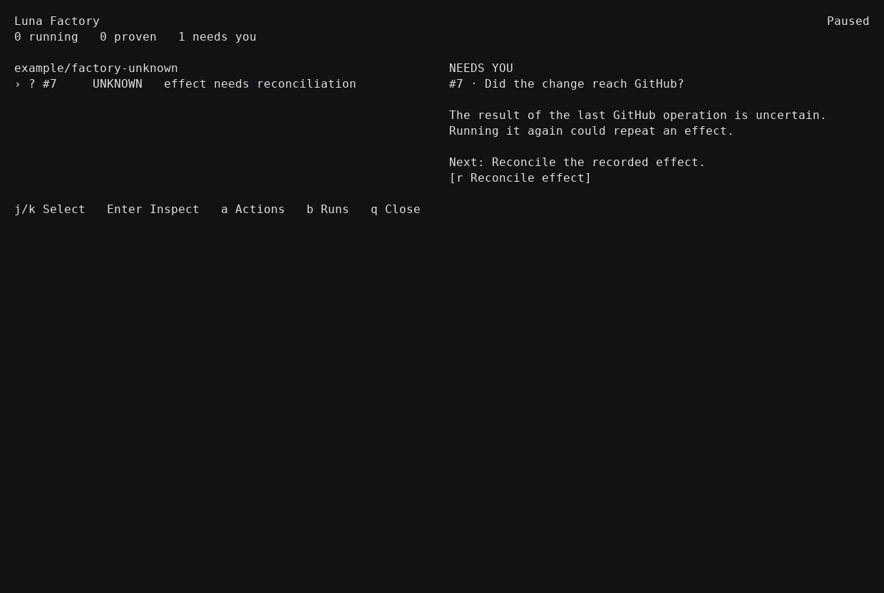
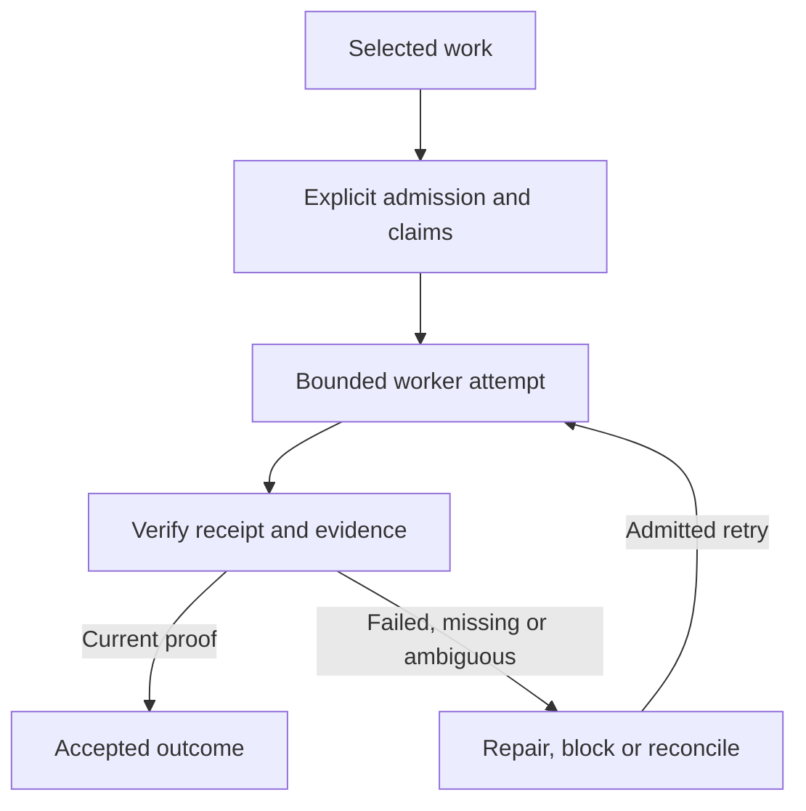

# Luna Factory workbench

**Bounded worker batches with explicit admission, durable claims, and evidence.** Luna Factory is an OMP extension packaged alongside Review. It owns its execution state separately from Review's GitHub queue.

[Main README](../../README.md) · [Review workbench](review.md) · [Factory operating model](../factory/agentic-model.md) · [Factory operations](../skills/factory-operations.md)



*Repository checkpoint image showing an unknown outcome. Consult the [dashboard checkpoint](../factory/dashboard-checkpoint.md) for context; an unknown outcome is not proof of completion.*

## Enable and inspect

Factory execution is opt-in. The following enables the packaged launch; it does not itself dispatch a batch:

```sh
LUNA_FACTORY_ENABLED=1 review acme/widgets
```

Factory-enabled startup qualifies the selected runtime with a verifier preflight and a harmless sandbox test. A failed probe blocks startup. In an interactive session, `/factory` opens the dashboard. From Review, `F` opens the Factory action picker when the extension is loaded. See [Factory dashboard controls](../appliance.md#factory-dashboard).

## Lifecycle



A returned worker is not proof of success. Factory checks the receipt against the current task, attempt and subject. Changed subjects can invalidate earlier proof. Missing or contradictory evidence stays blocked or unknown. Claims coordinate single-writer resources; cancellation or stop does not imply that external effects were rolled back.

`CONVERGED` means all mandatory acceptance criteria have current valid proof. `QUIESCENT` means no authorized autonomous progress remains; it may still be unconverged. A visible Review row does not admit work, and Factory completion grants no approval, merge, publication or deployment authority.

## Inspect and resume

The dashboard exposes batch history, attempts, evidence, ownership and available actions. Retained runs can be inspected and resumed according to their state; the same-host state root is authoritative for ownership and recovery. Stop prevents further dispatch but does not undo external effects. Review the [operating model](../factory/agentic-model.md) and [Factory operations](../skills/factory-operations.md) before acting on a blocked or unknown outcome.
