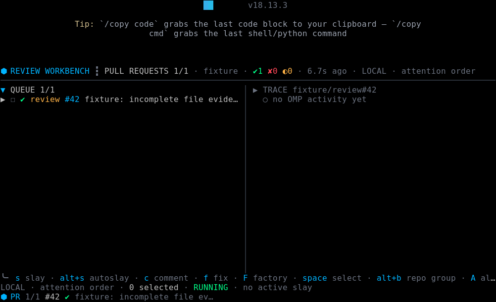
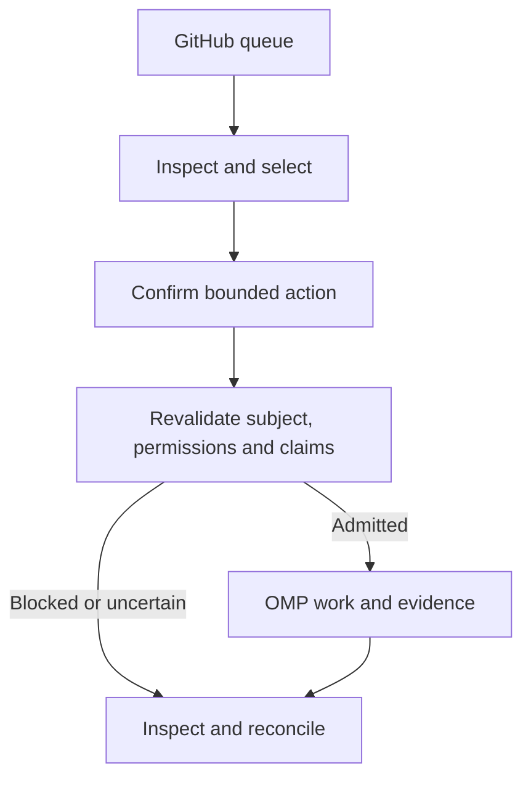

# Review workbench

**A live GitHub queue, bounded evidence, and a place to decide what to do next.** Review is an Oh My Pi extension packaged in the Review appliance. It accepts a repository or organization and projects pull requests and issues into an interactive terminal workbench.

[Main README](../../README.md) · [Detailed controls and recovery](../skills/review-dashboard.md) · [Agentic model](../factory/agentic-model.md)



*Source-runtime capture with a deterministic fixture. The queue is on the left; the historical session trace is on the right. In the current workbench the selected-item Inspector and the session-wide trace are distinct views. This is not a live GitHub session or evidence of completed work. [Capture notes](../evidence/review-workbench/2026-10-29/cloud-ansi/README.md).*

## Start and navigate

```sh
review acme/widgets
```

Authenticate with GitHub and a model provider first; see the [quick start](../../README.md#quick-start). `org:acme` selects an organization. A queue row is an observation of GitHub state, not a worker assignment.

| Key | Action |
| --- | --- |
| `Tab`, `j` / `k` | Switch PR/issue queues and move through items |
| `Space` | Select the focused item |
| `d` | Inspect a bounded PR diff or issue discussion |
| `r` | Refresh GitHub evidence |
| `s` | Start a confirmed bounded review/repair lifecycle |
| `f` | Fix selected work in isolated workspaces |
| `F` | Open the Factory action picker when Factory is loaded |
| `?` | Show help |

See the [full control reference](../skills/review-dashboard.md#core-interaction), including selection, filtering, trace navigation and scope changes.

## From selection to outcome



Review specialists are read-only. Confirmed human intent can delegate a bounded coordinator lifecycle, subject to current permissions, rules, exact-head checks, and claims. Workers and coordinators do not approve or merge their own work. Missing or ambiguous evidence stays blocked or unknown.

## Sessions and recovery

OMP owns sessions and execution; Review persists selected work and relevant intent. On interruption, Review reconciles external effects before resuming. `/review recap` presents a bounded summary; `/review handoff` prepares a new session without granting it mutation authority. Use `/review resume` or the saved-work prompt only after the applicable recovery checks. See [interrupted wave recovery](../skills/review-dashboard.md#interrupted-wave-recovery) and [appliance state](../appliance.md#isolation-and-state).

## Next

Open [Luna Factory](factory.md) for opt-in bounded batches, or the [launcher guide](../skills/launcher.md) to configure runtime and credentials.
